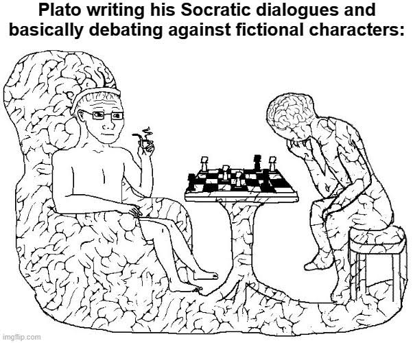

# Dialogue with Idols



*A warm reading room for asking questions of ideas preserved in books.*

## Why I made it

I have always admired great thinkers and wished I could sit down and talk with
them. Most of them are long gone, so that dream is mostly impossible. Their
books remain, though, and I wondered whether AI could help me explore those
ideas in conversation while showing the passages behind each answer.

Project Gutenberg collects many of these works and makes them freely available
in formats that are practical to read and process. This project is my attempt
to bring that conversation a little closer. It is an early retrieval-augmented
generation (RAG) demo: it searches a book and drafts an answer from retrieved
passages. It does not recreate a historical person's mind or voice.

The name is a playful nod to Nietzsche's *Twilight of the Idols*. If the idols
are gone, perhaps I can bring them back for a chat—with citations, of course.


## Try the app

The public demo is designed so a visitor can start without importing a book or
thinking up a question first:

- *The Prince* and *The Art of War* are already indexed, with *The Prince*
  selected at startup.
- Three question suggestions appear for the selected book. Choosing one fills
  the question box; it does not generate an answer.
- **Find passages** searches the book and shows source passages and context.
- **Generate cited answer** asks the model to answer from retrieved passages
  and shows the citations supporting each claim.

The demo is read-only: visitors cannot import books, and generated answers
remain in the current browser session. It allows up to three generated answers
per session. The full local app also starts with the bundled sample books and
allows Gutenberg imports, local file uploads, and saved discussions.

## Run locally

Python 3.12 is recommended. From the repository root, install dependencies and
start the full app:

```powershell
python -m venv .venv
.\.venv\Scripts\python.exe -m pip install -r requirements.txt
.\.venv\Scripts\python.exe -m streamlit run src/discussion_app.py
```

Open **http://localhost:8501**. The bundled books can be searched immediately.
Import another book from the sidebar using a Gutenberg URL or number, or upload
HTML, plain text, EPUB, or a supported ZIP file. Passage search does not require
an OpenAI API key. Answer generation does.

Keep `OPENAI_API_KEY` and `OPENAI_MODEL` in a private `.env` file or
`.streamlit/secrets.toml`; both are gitignored. Start from `.env.example` in a
fresh clone, and never commit real credentials.

To run the search-only page, which makes no OpenAI requests:

```powershell
.\.venv\Scripts\python.exe -m streamlit run src/search_app.py
```

## Deploy on Streamlit Community Cloud

The public portfolio entry point is `src/demo_app.py`. The repository must be
on GitHub, and the connected GitHub account needs admin access to it.

1. Sign in at [Streamlit Community Cloud](https://share.streamlit.io/).
2. Create an app from repository `dophat1/dialogue-with-idols`, branch `main`,
   with main file `src/demo_app.py`.
3. Select Python 3.12 in Advanced settings.
4. Add these values to the app's private **Secrets** field, replacing the
   placeholders. Do not put real values in GitHub files.

   ```toml
   OPENAI_API_KEY = "your OpenAI API key"
   OPENAI_MODEL = "your model name"
   ```

5. Deploy. The first launch downloads the embedding and reranking models, so
   startup can take a few minutes. Check the app logs if launch fails.

The demo uses the owner's OpenAI account. Its per-session answer cap is a
convenience, not an account-wide spending limit; set a project budget before
sharing the URL. Community Cloud apps may sleep when idle and have limited
memory, so check the app before sharing it with a reviewer.

## How it works

### Import and extraction

The importer accepts Gutenberg book pages, ebook numbers, direct download URLs,
and local HTML, XHTML, plain text, EPUB, and text/HTML ZIP files. It extracts
book metadata, chapters, paragraphs, and source locations where available.
Failed imports do not replace working indexes. Full book content, indexes, and
saved answers are stored locally and excluded from Git; the two demo indexes
are bundled in `demo_library/` for immediate use.

The upload limit is 50 MB; ZIP archives are limited to 100 MB unpacked and
3000 entries. Image-only scans, arbitrary PDFs, audio, and video are not decoded
and no OCR is performed. A readable Gutenberg text or HTML edition is required.
Some unusual HTML may fall back to continuous text, which can lose paragraph
structure and source anchors. Automatic author/editor attribution is not
guaranteed for editions with unmarked commentary.

### Retrieval and answers

New imports use the multilingual
`sentence-transformers/paraphrase-multilingual-MiniLM-L12-v2` embedding model.
Search combines semantic similarity with phrase-aware BM25 lexical matching
using reciprocal rank fusion. A cross-encoder reranks candidates with nearby
paragraph context. English books use
`cross-encoder/ms-marco-MiniLM-L6-v2`; other or unknown languages use
`cross-encoder/mmarco-mMiniLMv2-L12-H384-v1`.

Answer generation sends the question and selected evidence to OpenAI. It uses
up to six retrieved paragraph excerpts and attaches source IDs to claims. The
app checks citation membership and basic answer consistency, but this does not
prove that every claim is entailed by its citation. Retrieval scores are not
confidence or truth probabilities. When the retrieved text is insufficient,
the model is instructed to qualify or abstain. Answers remain fallible and
should be checked against their linked passages.

## Quality evaluation

A first small evaluation was run on 2026-11-10 using 20 questions across *The
Prince*, *The Art of War*, *Alice's Adventures in Wonderland*, and *The Raven*.
Ten questions were marked for development and ten for a first holdout check.
The labels and claim review were AI-assisted and still need independent human
review. This is diagnostic evidence, not a general accuracy estimate.

| Check | Result |
| --- | ---: |
| Preselected evidence found in the first six results | 14/16 answerable questions (87.5%) |
| All preselected paragraphs found in the first six | 13/16 (81.3%) |
| Mean reciprocal rank of the first preselected paragraph | 0.557 |
| Unanswerable questions returned with insufficient evidence and no claims | 4/4 |
| Answers produced without a validation error | 19/20 |
| Generated claims judged fully / partly / unsupported | 23 / 6 / 1 out of 30 |

The review found missed source labels, one answer that did not address its
question, one rejected answer, and claims that added detail beyond their
citations. These cases point to retrieval and claim-support checks that need
more work. For example, a *Prince* question about mercenaries retrieved other
passages that answered it, showing that its original expected-source label was
incomplete. An *Art of War* question about what is better than winning every
battle missed the passage about overcoming resistance without fighting; the
generated answer instead discussed preserving an enemy country. One answer was
rejected by validation, but that run did not record the exact cause. Some
accepted answers also added detail or certainty beyond their citations.

The local evaluation runner is
`.\.venv\Scripts\python.exe -m evals.quality_eval` (add `--answers` for paid
API generation). It reads a locally curated question set and writes full
retrieved passages and outputs to gitignored `docs/` files. That question set
and detailed transcript are not included in a fresh clone. The labels and claim
review need independent human review before making broad accuracy claims.

Run the automated tests and the small retrieval regression check with:

```powershell
.\.venv\Scripts\python.exe -X utf8 -m unittest discover -s tests -v
.\.venv\Scripts\python.exe -X utf8 -m evals.retrieval_smoke
```

The automated tests stub model and API calls; they do not establish live model
accuracy. See [DEVELOPMENT.md](DEVELOPMENT.md) for separate live checks.

## Where it could go next

The long-term aim is a conversation that feels closer to talking with an
author, while staying honest about what the sources can support:

1. Build author-grounded personas that answer from multiple works and cite
   their sources, while distinguishing documented views from interpretation.
2. Let multiple personas discuss a topic and make their disagreements and
   evidence visible to the reader.
3. Improve evaluations for citation support, faithful attribution, useful
   disagreement, and honest handling of gaps in the texts.

These are future directions, not current features. A persona would be an AI
interpretation grounded in surviving works, not the historical person brought
back to life.
